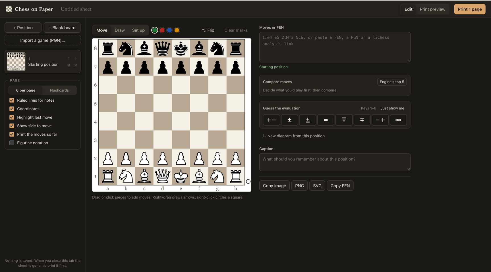

```text
 ██████╗██╗  ██╗███████╗███████╗███████╗
██╔════╝██║  ██║██╔════╝██╔════╝██╔════╝
██║     ███████║█████╗  ███████╗███████╗
██║     ██╔══██║██╔══╝  ╚════██║╚════██║
╚██████╗██║  ██║███████╗███████║███████║
 ╚═════╝╚═╝  ╚═╝╚══════╝╚══════╝╚══════╝
 ██████╗ ███╗   ██╗   ██████╗  █████╗ ██████╗ ███████╗██████╗
██╔═══██╗████╗  ██║   ██╔══██╗██╔══██╗██╔══██╗██╔════╝██╔══██╗
██║   ██║██╔██╗ ██║   ██████╔╝███████║██████╔╝█████╗  ██████╔╝
██║   ██║██║╚██╗██║   ██╔═══╝ ██╔══██║██╔═══╝ ██╔══╝  ██╔══██╗
╚██████╔╝██║ ╚████║   ██║     ██║  ██║██║     ███████╗██║  ██║
 ╚═════╝ ╚═╝  ╚═══╝   ╚═╝     ╚═╝  ╚═╝╚═╝     ╚══════╝╚═╝  ╚═╝
```

**Print positions. Study by hand.**



## Why

Chess on Paper is for people who study chess with a pen: working through a position on
paper and writing their own notes beside it. Getting positions onto paper is the tedious
part. Drawing boards by hand is slow, and screenshots print badly. This app turns a game or
a position into a print-ready A4 sheet, with each diagram beside ruled lines for your notes.

## How to use it

1. Open https://samkerr.github.io/chess-on-paper/.
2. Enter a game or a position.
3. Add a diagram for each position you want to study.
4. Print the sheet and pick up a pen.

To run it yourself:

```bash
npm install
npm run dev        # http://localhost:5173
```

## Licence

Chess on Paper is free software under the GNU General Public License, version 3; see
[`LICENSE`](LICENSE).

- Piece artwork: the cburnett set by Colin M.L. Burnett (BSD/GPL/GFDL), via python-chess.
- Engine: Stockfish 19 (GPL-3.0) via stockfish.js, vendored unmodified in `public/engine/`
  with its licence text; [`public/engine/README.md`](public/engine/README.md) says where
  its source is.
